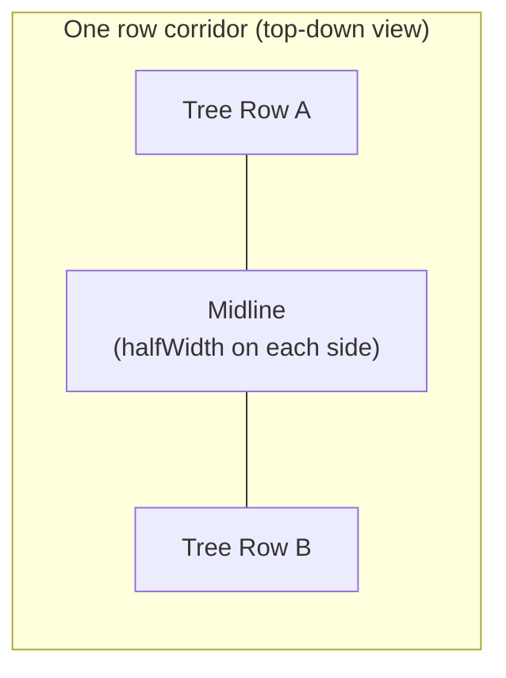
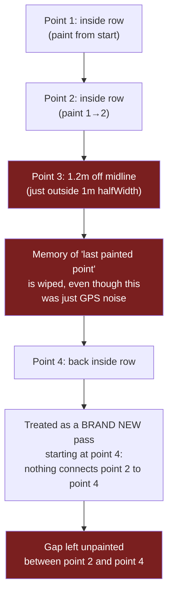
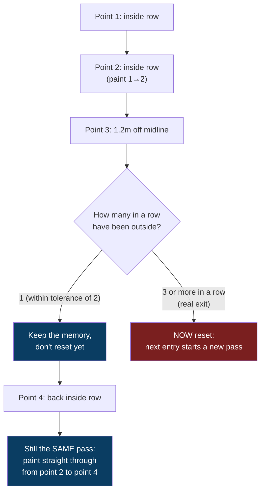

# Why the Coverage Heatmap Showed Gaps (and how it's fixed)

> **File:** `lib/features/plot_mapping/presentation/utils/row_line_coverage.dart`
> **Function:** `RowLineCoverage.buildHeatmapCoverageBands()`
> **Affects:** GPS, Speed, and Left/Right heatmaps on Monitoring and Report Details (all three share this one function)

---

## 1. The symptom

On a plot with tight row spacing (e.g. **Anjanadri_4**, 2 metre rows), the coverage
heatmap showed small, scattered gaps along almost every row — dashed instead of
solid, even though the sprayer drove those rows continuously with no real stops.

It looked like a data/connectivity problem. It wasn't — telemetry was arriving
normally (checked: median ~1 second between GPS points for that session). The
real cause was purely how the app decided "is this GPS point still inside the
row I'm currently painting?"

---

## 2. The setup: rows are painted as narrow corridors

Each gap between two tree rows is treated as a corridor. A GPS point only
counts as "in this row" if it falls within `halfWidth` of the corridor's
midline — and `halfWidth` is just half the row spacing:

For a 2 m row spacing, `halfWidth` is only **1 metre** on each side of the
midline. Ordinary consumer GPS accuracy is commonly **2–5 metres** — so a
completely normal GPS wobble can easily push a single reading just outside
that 1 m band, even while the sprayer is physically still driving straight
down the row.

---

## 3. Why one noisy point broke the whole row's paint job

The code paints a corridor by connecting each GPS point to the *previous*
point it saw inside that same corridor — that's what fills in the gaps
between sparse GPS samples. But the moment any single point fell outside
`halfWidth`, it threw away that memory entirely.

### Before the fix

One noisy sample — lasting a fraction of a second — permanently erased the
connection between the point before it and the point after it, leaving a
visible unpainted stripe right there. Because GPS noise is random and
constant, this kept happening every few seconds, all along every row —
exactly the dashed pattern seen on screen.

---

## 4. The fix: tolerate a couple of noisy points before giving up

Instead of wiping the memory on the very first out-of-band point, the code
now waits for **2 consecutive** out-of-band points before deciding the
sprayer genuinely left the row (e.g. a real headland turn). A single noisy
reading no longer breaks the connection.

### After the fix

A genuine exit — the sprayer actually leaving the row for a headland turn —
still resets correctly, because that shows up as *several* consecutive
out-of-band points in a row, not just one.

---

## 5. What this does and doesn't change

**Only affects:** how gaps get *painted in* between GPS samples on the
heatmap display.

**Does not touch:**
- Which point belongs to which row (`halfWidth` / corridor boundary is
  unchanged) — no risk of a point being miscounted into the wrong row.
- Any report number — Total Sprayed, Area Covered, Chemical Saved %,
  Avg Flow Rate, distances, etc. All come from a completely separate
  backend calculation (`session_service.py`) that this file has no part in.

**Minor accepted trade-off:** if the sprayer genuinely left a row for
1–2 GPS readings (a second or two) and immediately came back, it's now
treated as one continuous pass instead of two. In practice this has no
visible effect, since the sprayer was still in the row either way.
