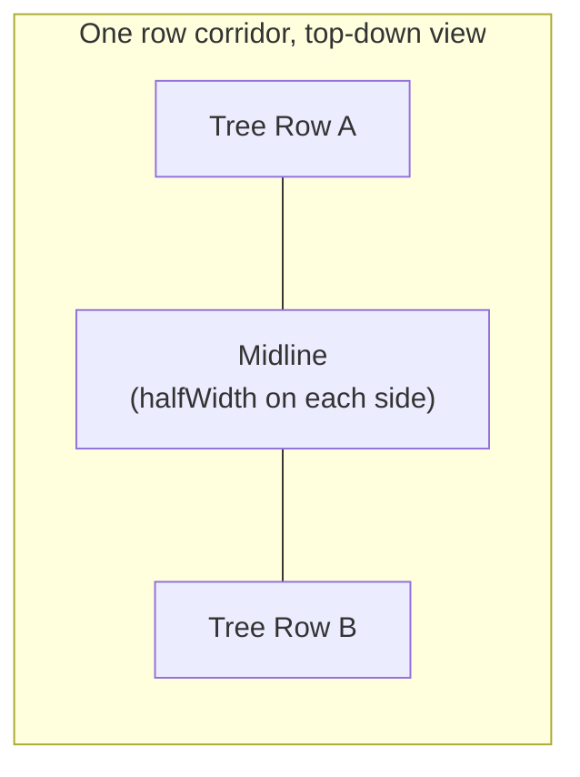
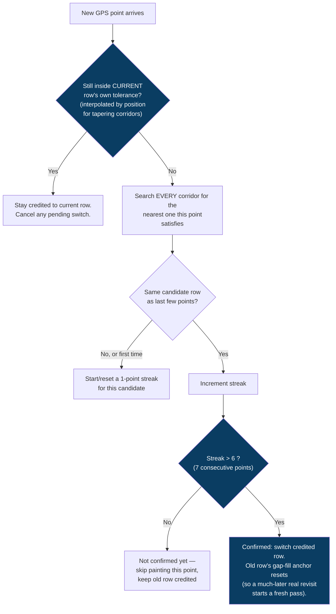
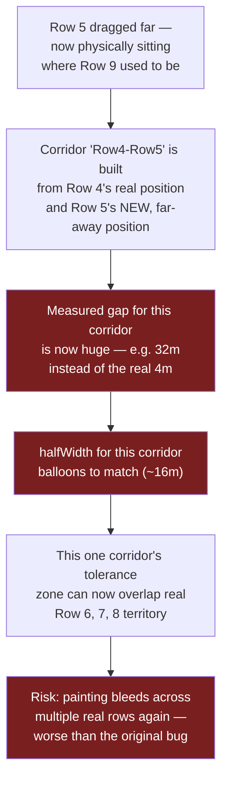
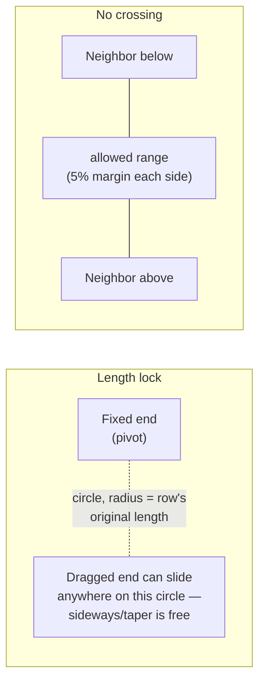
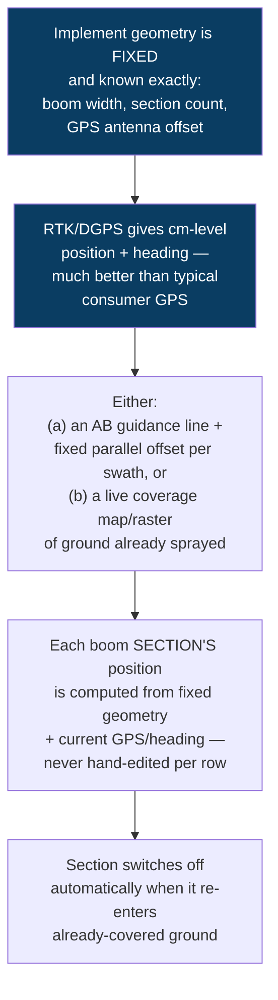

# Row-Corridor Heatmap: Problem, Fix, Open Risks, and the ISOBUS Alternative

> **Purpose of this doc:** background for a discussion with the manager on how we
> currently decide "which row is the sprayer in" for the coverage heatmap, what we
> just fixed, what's still fragile, and how the agricultural industry's own
> standard (ISOBUS Section Control) solves the same problem differently.
> **Status:** Both the heatmap fix (§5) and the row-editing constraints that
> close the "dragged far out of sequence" risk (§7) are implemented and
> shipped. §8-10 (the design tension and the ISOBUS comparison) remain the
> open discussion points.

---

## Table of Contents

1. [One-paragraph summary](#1-one-paragraph-summary)
2. [The problem](#2-the-problem)
3. [How the app decides "which row" — the corridor model](#3-how-the-app-decides-which-row--the-corridor-model)
4. [Root causes found (three separate bugs)](#4-root-causes-found-three-separate-bugs)
5. [The fix that shipped](#5-the-fix-that-shipped)
6. [How we verified it](#6-how-we-verified-it)
7. [Open risk: a row dragged far out of sequence](#7-open-risk-a-row-dragged-far-out-of-sequence)
8. [The deeper design tension](#8-the-deeper-design-tension)
9. [How the industry does this: ISOBUS Section Control](#9-how-the-industry-does-this-isobus-section-control)
10. [Side-by-side comparison](#10-side-by-side-comparison)
11. [Discussion points for the manager](#11-discussion-points-for-the-manager)

---

## 1. One-paragraph summary

The coverage heatmap (GPS / Speed / Left-Right views on Monitoring and Report
Details) paints the sprayer's path onto "corridors" — the gap between two
drawn tree-row lines. Real GPS is noisy (a few metres of natural jitter) and
real fields aren't perfectly uniform (row spacing can vary, especially after a
farmer manually nudges a row line to match reality). Both of those exposed
real bugs: gaps in an otherwise-continuous row, and worse, a single row's
paint bleeding into a neighboring row. We fixed the bugs we found and verified
the fix against a real recorded session. But the fix works by trusting
whatever row geometry is currently drawn — which raises a real question: is
that the right foundation to build on, or should row/section identity come
from something more rigid, the way real precision-ag hardware (ISOBUS Section
Control) does it? That's the discussion this doc sets up.

---

## 2. The problem

Three distinct symptoms showed up, in this order, each on a real device/plot:

1. **Gaps in the heatmap** — a row that the sprayer drove continuously showed
   as dashed, broken segments instead of one solid line (seen on `Anjanadri_4`,
   2m row spacing).
2. **One row's data bleeding into 4-5 neighboring rows** — a single continuous
   pass down one row got scattered across several adjacent columns instead
   (seen on `mana pudi`).
3. **The same row's credit flip-flopping back and forth** at one specific spot
   in the field, even after fixing #2.

None of these were caused by bad connectivity, backend bugs, or the recent
report-calculation fixes (Avg Flow Rate, Sol. Off, etc. — those are a
completely separate part of the codebase, `session_service.py` on the
backend). All three live in one Flutter function:
`RowLineCoverage.buildHeatmapCoverageBands()`.

---

## 3. How the app decides "which row" — the corridor model

Two tree rows drawn on the map define a **corridor** — the strip of ground
between them, where the sprayer is expected to drive. A GPS point counts as
"in this row" if it falls within `halfWidth` of the corridor's midline:

Row lines come from two places:
- **Auto-generated**: the app draws one guide line, then fills the whole
  plot with parallel lines spaced at the plot's configured `row_spacing`
  (e.g. 4.7224m) — see `RowLineGenerator.generate()`.
- **Manually adjusted**: the farmer/operator can drag either endpoint of any
  individual row line to match what's actually visible in the satellite
  image — real fields are rarely as perfectly uniform as an auto-generated
  grid assumes.

---

## 4. Root causes found (three separate bugs)

### 4.1 A single noisy point broke gap-filling (symptom #1)

The code fills in the gap between sparse GPS samples by remembering the last
point it painted in this corridor. The instant one point read outside
`halfWidth` — completely normal GPS wobble, worse with tight row spacing
(2m rows → only 1m tolerance) — that memory was wiped, so the next (perfectly
normal) point started a "new pass" instead of continuing, leaving a visible
gap.

### 4.2 No "home row" bias (symptom #2)

Each corridor tested points **independently** — "is this within *my*
tolerance?" — with no idea that a neighboring corridor existed. Near a wide
corridor's shared boundary, a point could be comfortably inside its true
row's tolerance *and* technically closer to a neighbor's midline by a
meaningless margin (e.g. 2.29m vs 2.31m). Because a purely "nearest wins"
rule doesn't play favorites, isolated points kept getting attributed to
whichever row was fractionally closer at that instant — scattering one
continuous pass across several columns.

### 4.3 One flat width for a tapering corridor (contributed to #2)

Real fields aren't rectangles. On `mana pudi`, one single corridor measured
**14.4m apart at one end and 4.7m apart at the other** — a triangular field.
Averaging those into one `halfWidth` for the whole corridor made the
tolerance far too generous near the narrow end, which is exactly where
ambiguity with the true neighbor is most likely.

### 4.4 Noise that outlasted the tolerance streak (symptom #3)

Even after fixing 4.1–4.3, one specific spot in a real session still had GPS
noise severe enough to exceed even a "3 consecutive points confirm a switch"
rule — the credited row flip-flopped for dozens of points before settling.

---

## 5. The fix that shipped

Four changes, in the order they were needed:

1. **Home-row advantage** (fixes 4.2) — a point is only compared against
   *other* corridors once it genuinely fails its *current* corridor's own
   tolerance. Removes the "fractionally closer neighbor" false alarm entirely.
2. **Per-position tolerance** (fixes 4.3) — `halfWidth` is tracked separately
   for each end of a corridor and interpolated by position along its length,
   instead of one flat average. A tapering corridor now has a tapering
   tolerance to match.
3. **Sticky single-pass tracking** (fixes 4.1) — one "currently credited" row
   is tracked for the whole continuous pass, not decided fresh per point.
4. **Higher confirmation streak: 7 points, not 3** (fixes 4.4) — tuned against
   the real noisy-boundary session; lower values still let sustained noise
   force a switch.

---

## 6. How we verified it

Rather than trust the reasoning alone, the exact algorithm was ported to a
standalone Python script and run against a real recorded session (1206
in-plot GPS points, `mana pudi`'s tapering field):

| Stage | Confirmed row switches |
|---|---|
| Before any fix (per-corridor independent, no history) | many scattered mis-paints |
| + nearest-row-wins only | 27 |
| + home-row advantage + tapered tolerance | 22 |
| + streak raised to 7 points | **14 — all genuine, each held 30-150+ points** |

The remaining 14 switches all matched a real, physically continuous
traversal across the field — no more flip-flopping at any single spot.

---

## 7. Closed risk: a row dragged far out of sequence

Everything above originally assumed a manual edit was a **small, local
correction** — a farmer nudging a row a metre or two to match what they see
in the image. Nothing stopped a row being dragged much further, into
territory that logically belongs to a completely different row:

The row's *array position* (its index — "row 5") never changes when you drag
it; only its coordinates do. So a wild edit doesn't just mis-place one row —
it can silently corrupt the tolerance calculation for its two neighboring
corridors, in a way that isn't obvious just from looking at the map.

**Fixed — by construction, not a cap.** Rather than capping the *derived*
tolerance after a bad edit already happened (which still leaves the row's
own geometry broken, just bounds the damage), the drag handler itself
(`row_line_screen.dart`) now makes both failure modes structurally
impossible:

1. **Length lock** — the dragged endpoint is held on a circle of the row's
   original length around its other (fixed) end, every frame of the drag.
   It can move freely *sideways* (so tapering — closer to one neighbor at
   one end than the other, a real field shape) still works exactly as
   before, but the row can never become longer or shorter, which is what
   let one endpoint travel arbitrarily far in the first place.
2. **No crossing** — the endpoint can never pass the matching endpoint of an
   immediate neighboring row (a small margin so they can't even touch). Its
   sideways deviation is preserved exactly; only the position *along* the
   neighbor-to-neighbor line gets pulled back if it would cross.

Together, a row can never end up sitting in territory that logically
belongs to a different row — so the "Row 5 lands where Row 9 was" scenario,
and the coincidental-overlap failure it caused, can't happen at all anymore.
A tolerance cap was considered instead, but rejected: capping just the
*width* after a bad edit still leaves the corridor's *midline* computed from
broken geometry — locking the geometry itself, so it can't go bad in the
first place, is the more complete fix.

---

## 8. The deeper design tension

`row_spacing` is not just a map-drawing setting — it's a **physical constant**
tied to the sprayer hardware itself (nozzle/lidar spacing) and sent to the
device in its own config payload. In reality, row spacing in a well-planted
field should never actually vary.

So when the app derives tolerance from *whatever is currently drawn*, it's
implicitly trusting the drawing over the known hardware truth. That's a
deliberate trade-off, not an oversight — this app already let farmers
individually drag any row's endpoints before this fix existed, and disabling
that would resurrect the original "heatmap doesn't paint on a corrected row"
bug. But it does mean the system has no way to tell the difference between
*"the farmer fixed a real mapping inaccuracy"* and *"the farmer (or a bad
GPS reading during map creation) accidentally dragged this way off"*.

This is exactly the kind of decision that real precision-ag hardware avoids
by never allowing this kind of editing in the first place — see below.

---

## 9. How the industry does this: ISOBUS Section Control

*(General architecture, based on how ISOBUS/ISO 11783 Section Control and
guidance systems are commonly described publicly — not a claim of exact
ISO 11783 clause-level detail. If real ISOBUS certification is ever a goal,
confirm exact field/message specifics against the actual standard document.)*

ISOBUS is the standard protocol tractors/implements use to talk to each other
and to a guidance/display terminal. **Section Control (SC)** is the specific
function that automatically switches spray boom sections on/off to avoid
overlapping or missing ground. It solves the same underlying problem this
app has — "has this ground already been covered?" — completely differently:

Key structural differences from this app:

- **No per-row polygons at all.** There's no concept of "row 5's line" as an
  independently-editable object. Row/swath identity is a simple offset
  calculation from a single guidance line, using the implement's fixed,
  certified geometry.
- **No manual "drag this row" editing.** Because geometry is fixed and
  positioning is high-precision, there's nothing to manually correct — the
  math is exact by construction, not by matching a hand-drawn approximation.
- **Coverage is often tracked as area, not "which numbered row am I in".**
  For broadacre (non-row) spraying, Section Control doesn't need "rows" as a
  concept at all — it just remembers what ground is already covered and
  avoids re-covering it.
- **Requires RTK/DGPS-grade accuracy** (centimetres, not the metres-level
  accuracy of the GPS chips this app's devices currently use) — that
  precision is *why* ISOBUS can afford to skip the tolerance/corridor problem
  entirely. With consumer-grade GPS, some form of tolerance zone is
  unavoidable.

---

## 10. Side-by-side comparison

| | This app (hand-drawn row polygons) | ISOBUS Section Control |
|---|---|---|
| Row/section identity | Independently-editable line per row | Fixed offset from one guidance line |
| Handles irregular/curved fields | Yes — draw/edit each row to match reality | Limited — assumes fairly uniform parallel geometry |
| Needs a tolerance zone at all | Yes — GPS noise vs. row width is a real tension | Rarely — precision is high enough to avoid it |
| Risk from human error | Structurally prevented now (length lock + no-crossing on drag) | None — no manual per-row editing exists |
| GPS precision required | Consumer-grade (metres) is workable, with care | RTK/DGPS (centimetres) expected |
| Engineering cost | Lower — no special hardware, but more edge cases to defend against | Higher — RTK infrastructure, certified fixed geometry |

---

## 11. Discussion points for the manager

1. ~~Ship the safety cap~~ — done (§7), but as a structural constraint on
   editing itself rather than a cap on the derived tolerance.
2. **Decide the target GPS precision.** If devices are expected to stay on
   consumer-grade GPS long-term, some tolerance-zone approach (what we have)
   is unavoidable — the real question is how much more hardening it needs.
   If RTK/DGPS is ever on the roadmap, the ISOBUS-style fixed-offset model
   becomes realistic and would eliminate this entire class of bug.
3. **Is full manual per-row editing actually needed**, or would a lighter
   version (e.g. edit the *guide line's* angle/spacing once, regenerate all
   rows uniformly, no per-row endpoint dragging) get 90% of the real-world
   flexibility with far less risk than fully independent per-row polygons?
4. **This is not an ISOBUS-certified system today** — nothing here claims
   compliance. Worth deciding explicitly whether ISOBUS compatibility is
   ever a real product goal (e.g. to interoperate with third-party terminals)
   before investing engineering time chasing it.
